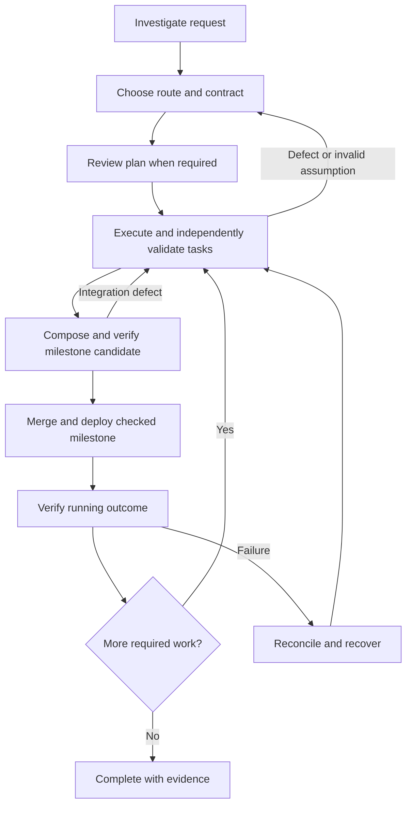

# Autonomous feature delivery

Status: **Draft for user review. Not accepted or implemented.**

Date: 2026-11-05

This spec describes the next layer of Crew: turning a feature request into planned, owned, independently verified work and carrying it through release. It records the direction discussed with the user and proposes concrete rules for review. The detailed mechanics below are recommended technical contracts, not user-approved implementation decisions. Section 17 separates confirmed product direction from recommendations and unresolved choices. No product code is changed by this document.

Related context: [current architecture](../../ARCHITECTURE.md), [existing vocabulary](../../CONTEXT.md), [profiles and project runs](../../crew-project-runs-spec.md), [OpenRig reference](../references/openrig.md). The feature-workflow explainer is a companion visualization, not the authoritative specification.

## 1. Problem and intended outcome

Crew currently coordinates native agents, project context, executions, and messages. It does not provide a durable definition of owned work, enforce a feature delivery process, or establish that a requested outcome has been achieved.

The operator wants to give Crew a goal and let it investigate, plan, implement, test, review, repair, merge, and deploy with a high degree of autonomy. The operator should not have to relay findings, dispatch each next step, or remind agents about unfinished work.

The primary users are:

- The operator, who supplies goals, preferences, constraints, and product decisions.
- Planning agents, which interpret requests and maintain actionable work.
- Workers and specialists, which execute bounded assignments.
- Validators and release agents, which establish evidence and deliver the result.

Success means Crew produces a verified outcome, retains an inspectable explanation of what happened, and recovers from interrupted agents without losing or duplicating ownership.

## 2. Product principles and autonomy

1. **Autonomous by default.** Ordinary planning and technical decisions do not require a human approval checkpoint.
2. **Ask for intent when it matters.** Crew asks the operator when competing outcomes cannot be resolved from the request, existing product behavior, or recorded preferences. It presents a concrete question, recommendation, and affected work.
3. **Proportional process.** Small changes can use a single issue. Larger or uncertain changes receive deeper investigation, specifications, and review.
4. **Explicit completion evidence.** Messages, terminal activity, acknowledgments, and worker confidence do not establish task completion.
5. **Independent verification.** An implementer cannot approve its own work. A different role label on the same implementing execution does not establish independence.
6. **Durable work.** Goals, contracts, ownership, findings, and progress survive individual conversations and coordinator restarts.
7. **Bounded execution.** Agent creation, retries, and external actions operate within configured project authority and resource limits.

The target product supports autonomous merge and deployment after required checks pass. This draft does not itself authorize this development session to commit, push, merge, deploy, or alter existing repository policies. A Crew project must explicitly establish the destination and authority for those operations before autonomous release is available.

### Specification basis and review scope

The user confirmed on 2026-11-05 that verified milestones should deploy as they become ready, with target and authority configured per project. GitHub is the proposed first repository host following the user's “github?” response; deployment infrastructure is still unspecified.

This revision retains the 18-section structure and the explainer's proportional workflow. Design work covers lifecycle, authority, recovery, artifacts, revisions, resource policy, and release reconciliation. Its acceptance bar is an explicit owner and evidence gate for every transition, a safe outcome for each failure scenario in section 16, and small independently observable implementation slices. Implementation and native-agent validation remain future work.

Repository inspection anchors the proposal:

- [database.ts](../../src/database.ts) uses SQLite migrations and immediate transactions; add work records there without replacing existing coordination storage.
- [crews.ts](../../src/crews.ts) captures execution generation, role, project, and cwd; authenticates execution credentials; and clears messages on successful shutdown. Work history must be retained separately.
- [managed-executions.ts](../../src/managed-executions.ts) verifies tmux and process receipts. Native activity is liveness/input evidence, not task progress or an expiring task lease.
- [daemon.ts](../../src/daemon.ts) reconciles executions before starting message delivery. Task reconciliation and scheduling are new responsibilities.
- Current launch guidance permits one project writer and does not restrict native tool permissions. Worktree isolation, stage grants, automatic recovery, and external-effect mediation are additions, not existing guarantees.

Reference inputs: kanban 2.4.0 `references/data-model.md` and `skills/{plan,factory,work,validate,integrate,replan}/SKILL.md` under `/Users/davidwu/.codex/plugins/cache/kanban-local/kanban/2.4.0/`. Adopt bounded issues, durable handoffs, atomic claims, independent probes, repair loops, and combined checks. Do not adopt mandatory human-authored feature specs, human-only crash recovery, fixed model choices, or PR-created-as-done semantics. The reference disagrees internally on the third versus fourth failed validation cutoff; section 13 defines Crew's own exact rule. An integration report's existence is not a passing verdict.

## 3. Proposed domain model

All records below are proposed. IDs are immutable and scoped to a project run unless noted otherwise.

| Concept | Contract |
| --- | --- |
| Feature | Outcome, exclusions, stable criterion IDs, accountable planning seat, current spec/plan revision, priority, delivery policy, resource envelope, and control state. |
| Spec revision | Immutable contract snapshot with parent revision, change rationale, criterion versions, assumptions, and decision references. Small features embed it in the issue; no separate document is required. |
| Task / issue | Same entity: bounded deliverable of kind `implementation`, `investigation`, or `planning`; contract revision, required criteria, outputs, dependencies, route, and one accountable seat. Accountability is distinct from an active claim. |
| Work attempt | One execution's effort on one stage; binds execution/generation, claim epoch, inputs, workspace, timestamps, usage, output, and handoff. Never a message delivery attempt. |
| Review | Immutable assessment of a precise input fingerprint, per-criterion verdicts, findings, reviewer identity, and evidence. |
| Artifact | Immutable content-addressed output, with producer attempt, digest, media type, storage reference, and availability. Git outputs additionally identify base, head, and retained Git objects. Branch names are locators, not revisions. |
| Task group | Temporary organization of seats around one feature objective, an accountable owner, assigned tasks, capacity ceiling, and exit criteria. |
| Integration candidate | Immutable set of task outputs composed on an exact target base, with combined revision and independent integration verdict. |
| Release | One candidate delivered to a configured target; includes operation journal, authority revision, external IDs, and running-outcome evidence. |
| Decision / blocker | Durable question or impediment with affected scope, resolver, next action, and resolution evidence. It is not only a message. |

A feature can have several milestones/releases. Initially a candidate belongs to one feature and one repository; cross-feature batching is deferred. Every task has exactly one owning feature and at most one owning group. Shared outputs use dependency references rather than duplicate task ownership. Initial dependencies stay within a project run; cross-run artifact exchange is deferred.

## 4. Feature lifecycle

Feature `phase` is one of `investigating`, `planning`, `executing`, `releasing`, `complete`. Independent `control` is `active`, `paused`, or `cancelled`. Blocking reasons are separate records; one question must not freeze unrelated tasks.

| Phase change | Authority and gate |
| --- | --- |
| Intake → investigating | Operator submits goal; daemon records feature and planner assignment request. |
| Investigating → planning | Planner records findings, assumptions, route, and remaining uncertainty. |
| Planning → executing | Planner activates a structurally valid plan; required independent planning reviews have passed. |
| Executing → releasing | Daemon observes a current, independently passed integration candidate for a milestone. |
| Releasing → executing | Daemon observes successful milestone delivery with required work remaining, or planner activates linked repair/replan work. |
| Any nonterminal phase → planning/investigating | Planner records replan/diagnosis trigger and affected scope; safe unaffected work can continue. |
| Executing/releasing → complete | Daemon evaluates section 14's completion predicate; no agent can set complete by assertion. |

The phase is a feature-level summary, not a lock on all tasks. While one milestone releases, later milestone tasks may execute. The daemon prioritizes a pending release in the summary; remaining work returns the summary to executing after that release resolves. For a non-deployed output, an explicit delivery record still supplies the completion gate.

Pause prohibits new assignments at that scope and reconciles active attempts (section 8). Resume is explicit by the operator, or by the planner only for a pause it created. Cancellation is terminal and does not undo merged or deployed changes. A changed goal after completion creates a successor feature. A newly discovered defect links repair work and marks affected prior evidence unusable for new decisions without rewriting the historical completion event.

## 5. Planning agent and specification quality

One accountable planning seat owns each feature; a replacement execution recovers its state from records. Planning itself consumes capacity. The planner interprets intent, inspects repository guidance and existing work, chooses routes and specialists, writes contracts, proposes dependencies and milestones, resolves technical disputes, and revises scope within the user's goal. It cannot dispatch beyond capacity, waive failed evidence, grant itself release authority, or declare complete.

The deterministic daemon schedules the planner as well as workers. It validates structure and authority, applies eligibility and priority rules, reserves resources, grants claims, enforces freshness and independence, records transitions, and reconciles external operations. It does not invent acceptance criteria, assess whether behavior is correct from raw logs, or choose a different product outcome. Agent judgment yields structured proposals/verdicts; daemon rules determine whether those records authorize advancement.

Each activated task contract contains outcome, exclusions, criterion IDs and observable assertions, required output types, input dependencies, verification commands or observation procedure, environment requirements, expected writable surfaces, route, and accountable owner. Planning review checks coverage of the original request, feasibility, dependency completeness, interface agreements, and whether verification can falsify incorrect behavior. An agreement without evidence does not settle a contested assumption; commission a bounded investigation.

Every feature criterion maps to one or more task checks plus a delivery/integration check where applicable. “No required criterion left unmapped” is a structural activation gate. Questions reference affected criterion IDs. Workers may choose local implementation details but cannot change acceptance meaning.

Intake bootstraps one bounded planning attempt from a system-defined contract (inspect request, classify, propose criteria/graph, identify intent gaps), so a planner does not need an already activated feature plan to begin planning. A provisional investigation plan may activate only bounded non-code investigation tasks and their artifact reviews; it cannot authorize affected implementation before design gates pass. Planning and diagnosis attempts use the same claims and budgets without recursively requiring another feature plan.

A planner may also implement a task when qualified and within capacity. That execution then becomes a contributor and cannot validate that task. A planning reviewer must not be an author of the plan revision it approves. Role names alone confer no mutation authority.

## 6. Task routing and proportional workflows

The planner records a classification vector: uncertainty (`resolved`, `bounded`, `unresolved`), impact (`local`, `cross-component`, `high-consequence`), interface coupling (`none`, `known`, `unsettled`), and verification (`established`, `new`, `unavailable`). It cites evidence for each value. These are inspectable judgments, not line-count scores.

| Route | Eligibility and mandatory preparation | Participants and exit gates |
| --- | --- | --- |
| Small | All of: resolved uncertainty, local impact, no unsettled interface, established verification. One issue holds the contract. | Planner triage, worker, independent validator; proportionate integration and delivery check still required. |
| Standard | Not small, but no unresolved consequential assumption, high-consequence impact, or unavailable verification. Brief spec and reviewed task graph. | Relevant independent planning reviewer, workers, validators, explicit integration owner. |
| Investigative | Any unresolved consequential assumption, high-consequence impact, unsettled critical interface, or unavailable required verification. | Bounded investigations, relevant specialist review, reviewed design/graph, and integration checkpoints before affected implementation. |

Authorization boundaries, irreversible data changes, credential handling, and broad compatibility changes count as high-consequence unless the planner supplies evidence for a narrower classification and an independent reviewer agrees. Urgency changes queue priority, not the minimum route. Unknown inputs route upward, never silently to small.

Route choice compiles to explicit required gates, capabilities, artifact types, and check policy stored with the plan revision. The scheduler enforces this envelope without interpreting issue prose. A worker discovering hidden coupling, an unavailable probe, or a contradictory assumption raises a route-review blocker on affected work. The planner can promote immediately; new gates must pass before affected work advances. Demotion requires an independent review of the revised risk assessment and cannot discard an unresolved failure. An investigative feature may contain small tasks once its uncertainties are resolved; the feature's cross-task gates still apply.

## 7. Agent selection, groups, and collaboration

A group records `id`, feature, objective, owner seat, member-seat responsibility grants, task IDs, interface artifact revisions, maximum active attempts, and exit predicate. It uses existing seats initially; dynamic seat creation and recursive group creation are deferred. Missing capability is a capacity blocker and a planner request, not an unsupported runtime launch. Initial runtime is Claude Code.

Group states are `forming → active → draining → closed`; `forming/active/draining → cancelled` is also legal after claims are reconciled. The planner creates and activates a group when its owner, scope, interfaces, and eligible responsibilities are recorded. A group may be active while temporarily waiting for a free seat. Draining prohibits new assignments; the planner closes it only after tasks are terminal or atomically transferred, no claims remain, and handoffs are retained. Cancellation transfers or cancels its tasks explicitly; it never loses them.

A seat may belong to multiple groups, but an execution holds at most one active stage claim across all groups and features. Membership consumes no execution slot; active attempts do. Limits apply simultaneously at daemon, project run, feature, and group levels; membership cannot multiply the global allowance. A task has one group owner or none. Transfer requires a versioned assignment change; active work transfers only at a reconciled handoff boundary. Group-owner replacement does not transfer worker claims.

The owner coordinates scope and interfaces but cannot approve its own contributions or override scheduler grants. Capability declarations and per-stage grants are separate from role prose. Specialists receive bounded tasks with expected artifacts, not untracked permission to edit another worker's workspace. Consequential independent investigations produce initial findings before reading each other's recommendations. Groups exchange artifact revisions and durable decisions through ordinary messages and task records; they do not create a shared conversation identity.

## 8. Task lifecycle and transition authority

Task `state` is exactly `draft`, `ready`, `implementing`, `validating`, `verified`, `integrated`, `accepted`, `cancelled`, or `superseded`. `accepted` is terminal for investigation/planning artifacts; `integrated` is the implementation milestone terminal state. Neither means deployed. `cancelled` and `superseded` are terminal; restored work receives a new linked task ID.

`validating` includes both queued and claimed validation; the claim determines whether a validator is active. `verified` similarly waits for candidate integration. `implementing` also names artifact production for non-code kinds. No state called `done` exists.

Blocking and pause are orthogonal: `control = active | paused`, plus zero or more unresolved blocker records. Display `validating · blocked: environment` rather than replacing the stage with a generic blocked state. Derived waits include dependencies, capacity, workspace preparation, and budget. A blocker stores reason category, resume stage, affected inputs, resolver, next action, and resolution evidence. Automatic expiry of a timer cannot resolve a product question.

All transitions are daemon transactions with expected record version and current input fingerprint. The table is exhaustive for ordinary task advancement; control/revision exceptions follow it.

| Transition | Initiator / authority | Required evidence and atomic effects |
| --- | --- | --- |
| Create → draft | Planner grant or operator | Feature, kind, owner, initial contract. |
| Draft → ready | Planner | Current complete contract, required plan reviews, criterion coverage, acyclic typed dependencies, resource/check policy. Dependency availability is not needed yet. |
| Ready → implementing | Scheduler only | Eligible task, prepared and verified workspace/input manifest, assigned execution, reserved capacity, exclusive claim. |
| Implementing → validating | Owning producer | Immutable output, criterion evidence, required self-checks passed, contributor identities, handoff. Close producer claim and freeze submitted output atomically. |
| Validating → ready | Claimed independent validator | At least one required criterion refuted or blocking correctness finding with reproduction. Save verdict, increment rework count, invalidate current output eligibility, close claim. |
| Validating → verified | Claimed independent validator; implementation only | Every required criterion confirmed, no unresolved blocking finding, exact current fingerprint. Close claim. |
| Validating → accepted | Claimed independent reviewer; non-code kinds only | Same verdict rule plus accepted output artifact present. Close claim. |
| Verified → integrated | Daemon after independent candidate verdict | Current candidate contains exact task output, target base, all required combined checks confirmed; record candidate association. |
| Implementing → ready | Owner yields, or recovery coordinator | Handoff/salvage record; old claim revoked; writable-resource safety established before replacement claim. |

A finding is blocking when it refutes a required criterion or demonstrates an introduced correctness, security, compatibility, or operational defect within the required check scope. It needs impact, affected revision/criterion, and reproducible evidence; style preferences alone do not block. The independent validator records severity and disposition. Nonblocking suggestions cannot waive a required criterion, and disputed blocking findings remain open pending independent review.

An inconclusive verdict closes the validation attempt, retains `validating`, and adds a verification blocker. On resolution a new validator claim resumes that stage. Refuted takes precedence when a verdict also contains inconclusive criteria; both findings remain open. Finishing a check command without reaching its assertions is not confirmation.

Control and revision operations:

- Planner or operator may block affected work; an owner may block its claimed stage; the daemon may block on an invariant/recovery failure. Resolving a blocker requires the named resolver's evidence and daemon rechecking of all remaining gates. Release any active claim through a handoff/reconciliation; blocking never silently grants a second writer.
- Operator may pause any scope. Planner may pause affected work for replan/diagnosis. Pause immediately rejects new claims and authoritative submissions, revokes current claims, and drains/reconciles processes. `pause pending reconciliation` is visible until resources are safe. A late output is retained only as salvage. Resume does not resurrect revoked claims: implementing returns to ready; validating stays validating with its frozen output if still current.
- Operator may cancel any nonterminal task. Planner may cancel/supersede it only under an activated plan revision that preserves required criterion coverage. Revoke claims and retain artifacts/history. Cancelling an ancestor does not satisfy dependents; they wait for a revised input edge.
- Revision activation may return ready/implementing/validating/verified work to draft or validating as section 12 specifies. There is no ordinary direct edit of `state`.
- Integrated/accepted history is immutable. A repair is a linked new task. Candidate/evidence validity can be revoked without pretending the historical transition never occurred.

Independence is checked against all contributor execution IDs for the reviewed output, including delegated writers and conflict-resolution authors. Initial policy also excludes the implementing seat across replacement generations for that task; restarting a seat is not an independence loophole. Validators work from isolated checkouts and never repair the reviewed output. A validator who needs to implement becomes a contributor and another eligible validator is required. Integration validation excludes contributors to any included output. The same independent validator may perform task and integration checks when eligible.

## 9. Scheduling, dependencies, and resource limits

The daemon runs a reconciliation/dispatch pass after relevant durable changes, on startup, and on a recommended five-second backstop timer. One serialized scheduling loop per daemon plus SQLite conditional updates protects against overlapping passes and concurrent API callers. It never holds a DB transaction while launching a process, preparing a workspace, or calling an external service.

Eligibility requires active feature/task controls, no unresolved blocker, current required planning verdicts, exact available prerequisite artifacts, eligible independent execution, capacity at every applicable scope, sufficient budget reservation, and usable workspace. The board returns all failed eligibility predicates, not merely “waiting.”

Use a documented lexicographic order, not hidden weights: operator priority descending; incident/repair urgency; required integration and validation ahead of new production at equal priority; deadline risk (`late`, `at-risk`, `unknown`, `on-track`); number of downstream tasks unblocked descending; eligible-since timestamp; immutable task ID. Planner supplies semantic priority/estimates; daemon computes graph and timing fields. Any priority override is recorded. Continuous higher-priority work may starve lower priorities; surface a wait-age alert rather than secretly changing operator priority.

Recommended pilot defaults: at most three active stage attempts per project run, at most two producers, one active attempt per execution, group ceiling no larger than its feature ceiling. When validation/integration is eligible, reserve one free slot for it; with a one-slot limit, drain existing work then validate before producing more. Existing idle seats still count against a separate configured live-process ceiling. Planning, specialists, workspace preparation reservations, and release recovery all count against their applicable budgets. Cross-run scheduling uses the same order and a daemon-wide ceiling configured at setup.

A dependency edge has `producerTask`, output name/type, minimum gate (`accepted`, `verified`, or `integrated`), pinned artifact digest, and consuming criteria. Default code edges require verified output; milestone boundaries can require integrated output. Edges are resolved to exact revisions before claiming. A consumer cannot start on “latest branch.” Artifact invalidation blocks transitive consumers until section 12's impact review. A repair/investigation may explicitly consume an invalidated snapshot as a diagnostic input under its own reviewed contract; this does not satisfy a normal verified dependency or restore that artifact's eligibility. This exception prevents repairs from depending on the defect already being fixed.

Ordering constraints are distinct from data dependencies: `after` edges serialize known conflicting interfaces; exclusive resource keys protect shared test environments or repository publication. Both edge types participate in cycle checks. Ordinary file overlap in isolated workspaces is a planning risk, not proof of an artifact dependency. If concurrent edits to an interface are intentional, record composition order and integration probes. Acquire all required exclusive resources in one reservation transaction; never hold one while waiting indefinitely for another.

## 10. Ownership, context, and recovery

A stage claim binds project run, task/candidate ID, stage, attempt ID, execution ID, generation, monotonically increasing claim epoch, contract/input fingerprint, workspace ID, and lease expiry. Stage grants are issued by the daemon to authenticated eligible executions; callers cannot choose another actor's identity. At most one live claim exists per task stage and per execution; task production and validation cannot overlap.

Recommended lease policy: renew every 30 seconds, expire after 120 seconds without an authenticated renewal. Use daemon receipt time, not client event time. A clock discontinuity or daemon restart triggers reconciliation, not automatic takeover. Expiry rejects authoritative submissions and begins recovery; it is not proof of process death. Native activity hooks cannot renew a lease without its current claim identity.

Claim/launch protocol:

1. Transactionally reserve attempt, capacity, epoch, and workspace identity with a stable request ID. Task stays queued while attempt is `preparing`.
2. Prepare inputs and launch/reuse an eligible execution outside the transaction. Since cwd is captured at launch today, never change an execution's cwd identity in place. A task requiring another worktree needs a safely stopped/relaunched seat or another eligible seat.
3. Recheck task version, controls, inputs, ownership, and capacity; grant claim, persist its complete assignment manifest/inbox entry, and record stage transition atomically. If any check changed, reconcile the prepared process/workspace and abandon the reservation.
4. Notify the execution of its durable assignment containing goal, contract, dependencies, guidance digest, claim, workspace, permissions, findings, and next steps. The assignment inbox persisted in step 3 is authoritative. Notifications use existing message semantics and can be missed or uncertain without creating a new attempt.

Attempt states are `preparing`, `active`, `submitted`, `yielded`, `revoked`, `failed`. Scheduler activation moves preparing to active; owner submission/yield closes active as submitted/yielded; coordinator revocation or definite execution failure closes preparing/active as revoked/failed. Terminal attempts never reactivate. A reservation that cannot activate within 120 seconds enters reconciliation and cannot retain a slot indefinitely without an explicit launch-status record. Workspace disposition is tracked separately as prepared, writable, frozen, quarantined, or released. Closing a claim does not prove its native process is idle or stopped. Keep execution/resource reservations until observed safe handoff or termination; no new assignment reuses that execution or writable resources earlier. A validator may inspect the immutable submitted output in isolation while the producer drains, within remaining capacity. Only active, unexpired claims can submit authoritative results. Duplicate submission with the same request ID returns its prior result even after the claim closed; a different payload under that ID conflicts.

Recovery first stops dispatch for affected resources, revokes the claim/epoch, and inspects native process identity using existing managed-execution checks. A verified live owner may renew an unexpired claim after reconciliation; a revoked/expired claim never revives. If safely stopped, salvage its output and create a fresh attempt. If ownership or subprocess termination is uncertain, quarantine the workspace and resource keys; do not kill an unrelated PID or reuse the checkout. A replacement may proceed only with proven isolation from every affected resource. Git worktrees share Git metadata and are not a security boundary: until managed process containment or a separate restricted clone proves that isolation, an uncertain writer blocks further writes to that repository.

A handoff contains intent, pinned inputs, modified files and immutable snapshot/patch, executed checks/results, decisions, unresolved findings, pending external operations, and next steps. Preserve every handoff revision. If a process crashes before writing one, the daemon records a partial salvage manifest and the replacement diagnoses it; absence of a handoff is not permission to invent success.

Restart order: reconcile native executions; claims and reservations; workspace/resource ownership; artifact availability; external operations; then enable scheduling. A crash after claim commit but before notification leaves one discoverable assignment. A crash after output storage but before submission leaves an unreferenced artifact, not a completed task. A crash after submission commit returns the same result on retry.

`crew down` must set dispatch disabled for the run before stopping executions. Successful stop revokes claims and preserves work history while existing message clearing proceeds. Failed shutdown keeps dispatch disabled with unresolved resources visible. Relaunch/resume explicitly enables dispatch after reconciliation; daemon restart alone never undoes a deliberate stop. This is proposed behavior extending the current shutdown contract.

## 11. Workspaces, validation, and integration

Code delivery requires Git; non-Git projects may use investigation/planning artifacts but cannot enter Git release stages. Uncommitted operator work in the canonical checkout is never reset, stashed, or implicitly imported. Choose an explicit committed base; required uncommitted changes must be deliberately imported as a recorded artifact before dispatch.

Recommended layout: task attempts use distinct worktrees under `<state-dir>/workspaces/<run-id>/<attempt-id>/`; validators and integration checks get separate worktrees. Each workspace records repository identity, canonical project binding, actual cwd, base SHA, dependency manifest, owner, and disposition. Task-aware launch must retain project-root guidance while accepting the registered external worktree cwd; current profile cwd restrictions do not already provide this. Guidance/configuration digest changes follow existing launch-mismatch behavior; never automatically replace a running execution merely to accept new guidance.

Default composition uses retained commit heads, not mutable stacked PR branches. Build a consumer base from a pinned target SHA plus verified dependency heads in topological order (ID tie-break), reusing already included ancestors. Record the resulting composed SHA. Workers create attempt-specific branches; validators check frozen submitted SHAs. No agent force-updates another attempt's ref. Rework starts from the prior snapshot in a new/reconciled workspace; its history and findings stay linked.

Before handoff, persist immutable Git objects under daemon-owned retained refs or bundles and non-Git evidence by digest. A branch push is not a prerequisite for local validation. Deleting a temporary workspace must not destroy output or proof. Validators derive criterion probes before reading the worker's success narrative, then reconcile results. Verdicts bind contract/criterion versions, source tree and commit, input artifact digests, guidance/check-policy versions, toolchain/environment fingerprint, and probe results. Environmental inability is inconclusive, not a product defect or pass.

Integration is a separate claimed candidate stage with one repository integration reservation. Candidate states are `assembling`, `checking`, `passed`, `failed`, `invalidated`. Assembling freezes included tasks, dependency closure, exact target base and composition order. Conflicts or behavioral failure record a failed candidate and linked repair work; never hide conflict edits in an integration verdict. A conflict-resolution author is a contributor and requires independent verification of the result. Checking passes only with all required combined journeys confirmed and no blocking finding. The integration controller alone moves assembling to checking once composition succeeds; a claimed independent integration validator authorizes checking to passed/failed. Composition failure moves assembling to failed. Inconclusive combined checks close the attempt and leave checking blocked with a recorded reason; a new independent claim resumes the same immutable candidate once that reason resolves. The daemon moves any non-failed candidate to invalidated when its inputs cease to be current; failed/invalidated candidates need a new candidate ID to retry. Only a passed current candidate can mark tasks integrated.

Integration checks the actual final composition even for a single task. Reusing identical task check results is permitted only when their complete fingerprint and required check scope match; cross-task checks are never inferred from individual passes. A repair after integration creates a new candidate including required predecessors and repairs. Revalidated candidates also record associations to already integrated tasks without repeating their historical state transition; feature completion uses current candidate validity, not the first integration event. Old candidates remain inspectable but cannot authorize release when invalidated.

## 12. Replanning and human decisions

Plan/spec revisions are immutable proposals with `proposed`, `reviewed`, `active`, or `rejected` status. Small initial plans may activate without a separate review; substantive amendments and standard/investigative initial plans require an independent plan reviewer. A planner publishes a delta listing retained, amended, added, superseded tasks, criterion changes, dependency changes, route changes, and impacted artifacts/verdicts. User input is required for materially different desired outcomes, not ordinary technical corrections within the goal.

Activation is atomic against the previous plan revision and affected record versions. First pause/revoke affected claims and reconcile their resources. Concurrent late verdicts cannot race revision activation. Unaffected tasks remain claimable. Proposed to reviewed requires the independent reviewer's passing verdict; proposed to active is allowed only for the small initial plan exception. Reviewed to active belongs to the planner through the activation transaction; proposed/reviewed to rejected belongs to the planner or operator with a reason. Each feature stores exactly one active plan pointer; activating a successor retains the former activation as history. Keep stable criterion IDs and increment a criterion version whenever its meaning or required evidence changes. Editorial metadata edits do not increment contract versions.

| Changed input | Required consequence |
| --- | --- |
| Wording-only metadata, no semantic/check change | Retain evidence; record editorial revision and reason. |
| Criterion, output contract, dependency, required route gate, or check policy | Invalidate affected verdicts and transitive consuming criteria. If impact mapping is absent or disputed, invalidate the entire task and dependency closure. |
| Submitted code/artifact changes | All verdicts for that output become stale. Revalidate the new output; passing an old SHA is insufficient. |
| Target branch advances before merge | Invalidate candidate readiness; recompose and check against new base. Retain task verdicts only if their inputs still match. |
| Environment/toolchain/guidance changes relevant to a check | Invalidate those checks; reviewer may document irrelevance explicitly. Never silently assume equivalence. |
| Already integrated/accepted output proves defective | Keep historical task event; revoke artifact/candidate eligibility and create linked repair tasks. Block dependent release/feature completion. |

For nonterminal affected tasks: incomplete contract returns to draft; changed contract needing implementation returns to draft then ready after review; unchanged frozen output needing only renewed verification returns to validating. In-flight production resumes as a new attempt. An independent reviewer can attest that a retained task is unaffected by a new feature spec, with an explicit old/new revision mapping; a global spec version bump alone need not erase every check. The daemon validates references and hashes, while the reviewer owns the semantic impact judgment.

Open findings carry forward across revisions and attempts until independently closed, explicitly superseded by an approved scope change, or accepted as nonblocking under the current contract. Deleting a criterion cannot automatically close its finding. An implementer cannot revise its own failure out of existence.

Operator decision records contain the question, recommended answer, alternatives/consequences, affected tasks, and answer provenance. No reply means unresolved. Technical diagnosis, dependency repair, or environmental retries proceed autonomously within authority. Decisions requiring a new product tradeoff, increased authorized budget, credentials, or external permission go to the operator while independent work continues.

## 13. Progress, deadlines, and budgets

Store distinct liveness, progress, and forecast records. Progress events reference a new artifact, decision, finding, or completed check; repeated log lines, tool calls, and heartbeats do not advance `lastMeaningfulProgressAt`. A running test records command, process identity, start time, expected duration, and status; exceeding its declared duration triggers investigation, not a fabricated milestone.

Recommended pilot alerts: at 15 minutes without meaningful progress ask for a structured checkpoint; at 30 minutes schedule diagnosis unless a recorded running operation explains the interval. Alerts are deduplicated per unchanged condition. They never automatically revoke a healthy claim or mark the task failed. Track productive time, queue time, human wait, infrastructure wait, and rework separately. Board progress is criterion coverage and stage counts; no claim that “90% of tasks” means “90% delivered.”

Forecasts use remaining task-stage duration ranges, dependency critical path, available capacity, and release/check time. Start with planner-supplied low/high ranges marked assumed. Later measured durations are grouped by route/stage with sample counts; do not call a range a statistical percentile without calibration. Calculate low/high finish bounds by two deterministic list-scheduling simulations using the section 9 order, dependency/resource constraints, and respectively low/high remaining stage durations. Include estimated repair allowance explicitly rather than hiding it in a percentage. Store forecast inputs, calculation time, and revisions. Recompute on graph, evidence, capacity, blocker, or estimate changes and every five minutes while active. An unresolved blocker without a bounded resolution time makes the upper bound unknown. Deadline status is late when the lower finish bound exceeds the target, at-risk when the upper exceeds it, unknown when unbounded/missing, otherwise on-track. Risk triggers a planner scheduling/scope recommendation; never automatic acceptance weakening.

Recommended retry policy, explicitly independent of the reference plugin:

| Failure class | Limit and response |
| --- | --- |
| Known transient infrastructure failure, no uncertain side effect | Two retries after the initial attempt, backoff 30 then 120 seconds; then infrastructure blocker and diagnosis. |
| Validation refutes output | Permit three repair attempts after the initial submission. A fourth refutation blocks more production and requires diagnosis plus reviewed replan. |
| Same reproducible failure twice consecutively | Diagnose before another identical attempt, even if repair budget remains. |
| Unknown external operation outcome | No blind retry; reconcile first (section 14). |
| Crash/launch failure | Counts toward infrastructure retries and total attempt budget; restart never resets counters. |

Counters are per task stage and failure class, with lifetime totals. A reviewed new approach may allocate a new retry envelope within remaining feature limits; it never erases prior spend. Diagnosis is bounded work, not a reason for immediate human escalation. After one diagnosis/replan fails to provide a viable approach within budget, retain a blocked state and ask for the consequential scope/resource decision.

Every run requires an explicit policy envelope before autonomous dispatch: maximum live processes/active attempts, total attempts, active runtime, and any supported spend/token cap. Recommended trial ceiling is 20 stage attempts and 120 active execution-minutes per feature, with 10% reserved for diagnosis/recovery; these are conservative trial settings, not measured estimates or user-approved costs. A stage attempt starts charging at preparation/launch; planner and reviewer work is included. Reserve an upper bound before launch, reconcile usage at completion, and return unused reservation. Recovery can use its reserve; ordinary production cannot.

Reported token/cost data may be unavailable from the native runtime. Show unknown rather than zero; do not promise an enforced dollar ceiling without a provider meter and bounded-stop mechanism. Enforce available attempt/time/process limits and reject a hard monetary policy the adapter cannot honor. On exhaustion, stop new chargeable work, checkpoint/reconcile active attempts, and add `budget_exhausted` blocker. Necessary status reconciliation remains available; new paid recovery requires remaining reserve or an explicit budget increase. Pausing does not stop a billing process by itself; elapsed runtime continues until confirmed stopped. Deadlines do not grant spending authority.

## 14. Release and definition of complete

**Confirmed direction:** deploy each verified coherent milestone when ready; keep the feature open for later milestones. Project setup specifies repository, protected target branch, supported merge strategy, deployment adapter/environment, authority boundaries, required checks, post-deploy probes and observation duration, recovery policy, and resource limits. GitHub is the recommended first host based on the user's tentative selection. A deployment target has not been selected. No deployment adapter means delivery is blocked, not implicitly complete; a genuinely non-deployed product must have an explicitly configured equivalent delivery target.

Release states are `draft`, `ready`, `merging`, `merged`, `deploying`, `verifying`, `succeeded`, `blocked`, `failed`, `cancelled`. `blocked` stores a resume phase and uncertainty reason. Release effects are executed by a daemon-mediated adapter under project authority; agent judgment requests operations but does not bypass the journal.

| Transition | Authority and evidence |
| --- | --- |
| Draft → ready | Daemon: current passed candidate, immutable manifest, required authority/check policy present, no blocking findings. |
| Ready → merging | Release controller claim: target reservation, expected base SHA and source SHA rechecked, checks fresh. Persist merge operation intent before network call. |
| Merging → merged | Adapter reconciliation: remote target contains the expected checked result, merge ID/SHA recorded. PR existence or closed status alone is insufficient. |
| Merged → deploying | Controller: deploy only the immutable merged/build digest, record environment reservation and operation intent. |
| Deploying → verifying | Adapter: deployment ID, target, digest, and successful rollout observed. |
| Verifying → succeeded | Independent release verifier confirms all required running criteria and observation window against that deployment, with no blocker. |
| Any nonterminal → blocked | Controller: authority absent, stale input, inconclusive probe, unknown effect, or missing environment; retain resume phase. |
| Blocked → recorded resume phase | Controller after evidence resolves blocker; recheck all phase prerequisites. |
| Active phase → failed | Controller: definite operation/check failure recorded; link recovery and repair work. |
| Any nonterminal → cancelled | Planner/operator request; controller commits only after all sent effects are reconciled and any required recovery has resolved. Record effects that remain in place; cancellation cannot claim they were undone. |

An explicitly configured delivery profile determines which effect stages apply. Artifact-only delivery permits ready to verifying once the immutable artifact is durably available; merge-only delivery permits merged to verifying; publication without Git merge permits ready to deploying with a journaled publication operation. The daemon allows these edges only when the activated contract declares that delivery target, and still requires independent outcome verification. These profiles cannot be selected merely because an application deployment is unavailable.

Cancellation requests immediately inhibit new delivery effects but permit observation and authorized recovery. An unknown operation stays blocked with cancellation pending until it is resolved. Failed/succeeded/cancelled releases are historical terminal records. Repair or retry after a definite failed release creates a linked successor release. Recovery operations remain attached to the failed release and must resolve before conflicting successor effects. A late negative observation after success creates an incident/repair; it does not erase the prior observation window.

GitHub adapter contract: inspect PR head/base, checks/reviews and branch protection, request an allowed merge, and observe actual target SHA. Initial recommendation is a fast-forward update of the exact checked candidate where permitted, or a merge strategy whose exact resulting tree can be established and verified. If GitHub/protection cannot ensure the checked result against the expected target base, block and use a supported merge queue/pre-merge mechanism; do not silently merge against a changed base. Squash/rebase SHAs require explicit tree/build provenance, not assumed SHA equivalence. A protected-branch refusal is a blocker, never permission to bypass protection.

Each external operation stores release, phase, request ID, expected revisions, target, authority revision, adapter, provider idempotency key if supported, external ID, and `prepared | sent | observed_success | observed_failure | unknown` status. Persist intent first. A timeout or crash between sending and recording becomes unknown. Query by external ID/key and reconcile exact source/target before retry. If the provider cannot distinguish not-started from started, retain blocked uncertainty for operator resolution; exactly-once side effects cannot be guaranteed by local SQLite alone. Retry only a proven not-started operation or through provider-enforced idempotency.

One merge reservation per repository/branch and one deployment reservation per target environment, across all runs in the same daemon. Hold deployment ownership through verification or reconciled recovery. An unrelated external deployment changing the observed digest invalidates the running check; never report another revision's success. Multiple daemons independently controlling the same target are outside initial scope unless the adapter provides remote locking/serialization.

Post-deploy failure records the failed assertions, starts the configured recovery (rollback only when explicitly supported and authorized), and creates repair work. A rollback is its own journaled operation and must be verified. Restoring the previous version does not satisfy the feature. Migrations must declare recovery constraints before ready; non-reversible changes cannot inherit an assumed rollback command. If external CI deploys automatically on merge, configuration must identify and observe that deployment instead of initiating a duplicate one.

Advancing the target invalidates an unmerged candidate's readiness, not the historical evidence of an already reconciled merge/release. Later milestones include earlier delivered changes in their base. The final milestone verifies cumulative required feature journeys on the final delivered digest; earlier milestone success alone cannot prove those journeys still work. A successor release may satisfy the delivery obligation of an earlier failed/cancelled release only through an explicit plan mapping with all required criteria covered.

Feature completion is a daemon predicate over the active plan: every required criterion has current confirming evidence at its required task/integration/delivery level; required implementation tasks are integrated and artifact tasks accepted; required milestone releases succeeded with matching revisions; no required work, unresolved blocking finding, pending decision, or uncertain external/recovery operation remains. Cancelled/superseded tasks count only when an activated plan maps their required criteria elsewhere or explicitly removes them with authorized scope change. The final report links delivered revisions/targets, evidence, and explicitly nonblocking limitations. A lack of runnable work never implies completion.

## 15. Durable storage, APIs, and board

Extend existing SQLite storage with features, immutable plan/spec revisions and criterion versions, tasks, typed edges, groups/memberships, stage grants, attempts/claims, resource reservations, artifacts, reviews/findings, blockers/decisions, integration candidates, releases/external operations, usage, and transition/outbox records. These are logical records; implementation may combine tables where constraints remain explicit. Do not introduce a second board database or require full event sourcing.

Every mutation uses authenticated actor, stable request ID, expected record version, and relevant claim epoch/fingerprint. One immediate transaction checks authority and invariants, updates current state, appends the event, stores the idempotent result, and creates any notification outbox entry. Replaying the same scoped ID/payload returns that result; ID reuse with different payload returns conflict. Stale expected version/claim/input returns conflict with current revision; unauthorized actor returns forbidden. No side effect happens before successful validation/reservation. Operator commands use the same gates and cannot manufacture a passing verdict.

External-effect authority is checked again before each journaled send, not only when the release was created. Revocation stops new effects; already sent effects still require reconciliation.

Stage grants permit specific operations at a scope: plan/revise, produce, validate, integrate-check, or release. Operator-issued project authority bounds these grants; the planner assigns responsibilities only within that envelope. Managed credentials retain existing project-run selection and generation checks. A role string, group membership, or possession of a task ID alone cannot grant transition privileges. Retired/inactive executions cannot submit authoritative evidence.

Recommended artifacts live at `<state-dir>/artifacts/<run-id>/<digest>`; workspace directories are disposable, evidence directories are not. Write/fsync/rename immutable content before committing a database reference. On read, verify digest and availability. Missing/corrupt evidence adds a blocker and invalidates dependent eligibility, not historical events. Keep retained Git objects as well as textual SHA references. Backups/export include both SQLite and referenced blobs/Git objects. Initially retain referenced artifacts indefinitely; garbage collection is explicit and rejects deletion of evidence reachable from retained history. Credentials stay in private runtime/adapter storage, never specs or evidence.

API/CLI operation families: feature intake/inspect/control; plan propose/review/activate; task list/show; assignment inbox/claim renewal/yield/submit; independent review submission; blocker/decision resolve; group assign/drain/transfer; candidate inspect/check; release inspect/reconcile; usage/forecast inspect. Exact command spelling can follow existing CLI conventions. There is no unrestricted `set-state` endpoint. Board queries expose state/control, queued versus claimed stage, owner/group, dependencies and pinned revisions, eligibility reasons, progress age, forecast assumptions, usage/reserve, findings, and delivery state. Board drag operations invoke validated commands.

Messages notify; records authorize. Decisions or evidence cannot reference only a message that `crew down` may delete. Durable assignment discovery and an outbox/backstop prevent missed notifications from losing work without changing the current uncertain-message retry contract.

## 16. Delivery increments and acceptance scenarios

These are proposed vertical implementation slices, not implementation performed in this session. Each can be exercised through CLI/HTTP with isolated storage and controlled native/external fixtures. Later slices depend on earlier safety contracts; parallel code writers remain disabled until slice 8. Maintain implementation evidence separately when coding begins.

| Slice | Scope and dependencies | Observable acceptance |
| --- | --- | --- |
| 1. Durable bounded task | Contracts, criterion IDs, state/control, events, idempotency, actor grants; no automatic agent dispatch. | Create/inspect through CLI/HTTP; restart preserves records; invalid jump and duplicate-ID/different-payload reject; same request returns one result. |
| 2. Owned stage attempt | Slice 1; execution-bound claims, leases, resource reservations, handoffs, assignment inbox. | Concurrent claims yield one owner; expired/replaced owner cannot submit; missed notification still exposes assignment. |
| 3. Safe stop/restart | Slice 2; reconcile claims/processes, interrupted preparation, run dispatch toggle. | Crash before/after grant does not duplicate ownership; uncertain writer blocks reuse; successful down clears messages but retains task and stops dispatch after restart. |
| 4. Single review loop | Slices 2–3; immutable artifacts, independent review, blockers, repair counters, baseline budget accounting. | Controlled worker submits, validator refutes, repair passes without operator dispatch; same-seat replacement cannot self-approve; inconclusive retains validation stage. |
| 5. Autonomous intake | Slice 4; small route, bounded planner task, criterion coverage and durable product questions. | Clear request produces one task; missing intent blocks only affected work; native trial demonstrates a real independent repair loop. |
| 6. Reviewed plan changes | Slice 5; standard/investigative routes, planning review, immutable revisions and impact mapping. | Hidden dependency promotes route; revision race rejects stale verdict; unaffected task continues; invalidated prerequisite blocks transitive consumers. |
| 7. Deterministic capacity | Slice 6; graph scheduling, exact retry policy, forecast/usage alerts, fixed-seat groups. | Cycle rejected; one-slot run validates before more production; shared group membership cannot double-spend slots; budget exhaustion stops dispatch without losing work. |
| 8. Isolated dependency work | Slices 3, 7; task-aware worktree launch, manifests, pinned dependency composition, retained Git objects. | Two independent writers use distinct cwd; consumer gets exact prerequisite output; dirty canonical checkout untouched; uncertain old writer cannot race a replacement. |
| 9. Integration candidate | Slice 8; serialized composition, independent combined checks, repair candidates. | Individually green tasks fail a cross-task probe; release readiness stays false until repaired candidate passes; moved base invalidates readiness. |
| 10. GitHub merge boundary | Slice 9; configured authority, GitHub adapter and durable operation journal, no deployment completion claim. | Head/base changes and protection reject unsafe merge; timeout after successful merge is reconciled without a second merge. Unsupported exact-result strategy blocks clearly. |
| 11. Pilot delivery | Slice 10 plus chosen deployment adapter/target; post-deploy check and recovery policy. | Verified milestone deploys while later work continues; timeout reconciles deployment ID/digest; failed probe prevents complete; successful final milestone satisfies completion predicate. |

Required adversarial scenarios (each must assert durable records and visible state, not just log output):

| Failure scenario | Required outcome |
| --- | --- |
| Two schedulers/callers race for the same task or the last capacity slot | One reservation/claim wins; loser observes current state; no second process is granted authority. |
| Worker reports success with missing evidence or probe never reached assertion | Submission/verdict gate fails; no verified state. |
| Worker restarts in the validator seat or hides a delegated writer | Contributor provenance and seat exclusion reject self-approval; missing provenance blocks review. |
| Heartbeats continue while work makes no progress | Progress alert/diagnosis, not lease theft or false advancement. |
| Lease expires while a native child still writes | Claim revoked; resource quarantined until stop/isolation established; late output is salvage only. |
| Validator crashes after a probe but before verdict commit | New claim reuses immutable inputs and reruns/attests evidence; no inferred pass from logs. |
| Plan changes while old verdict request is in flight | Compare-and-swap admits one ordering; revision activation invalidates any superseded verdict before downstream advancement. |
| Prerequisite passes, consumer starts, then prerequisite output is invalidated | Consumer paused/reconciled and impact reviewed; old integration candidate cannot release. |
| Integration report exists but contains inconclusive/refuted results | Candidate remains non-passing; report presence never suppresses required recheck. |
| Group closes while a member owns unrelated work | Group waits/transfers its own claims; unrelated execution is not terminated. |
| Required artifact disappears after workspace cleanup | Digest/availability gate blocks reuse; restore or regenerate and revalidate; history is retained. |
| Three permitted repairs fail and another identical attempt is requested | Circuit breaker blocks production; bounded diagnosis/replan required; counters survive daemon restart. |
| Unknown usage or budget reserve runs out | Report unknown/exhausted; do not treat missing meter as free work or raise budget silently. |
| Merge succeeds remotely, local response is lost | Operation remains unknown until remote SHA reconciliation; no blind repeat. |
| Target moves between check and merge | Conditional adapter/queue rejects or establishes checked result; recompose/recheck otherwise. |
| Deployment succeeds but worker crashes before reporting | Reconcile provider operation/digest, then run outcome checks; do not redeploy merely due to missing local acknowledgment. |
| Running probe fails after irreversible migration | Failed release, configured forward recovery or operator decision; never assume rollback or complete. |
| Operator cancels during uncertain deployment | Stop new work, reconcile in-flight effect, show actual target state and recovery obligations; cancellation is not rollback. |
| No task is runnable but feature criteria remain uncovered | Feature stays incomplete and exposes the coverage/blocker gap. |

Native trials must cover both a small request and a connected multi-task request, showing useful contracts and independent probes. Fixtures prove coordination behavior, not planning quality. No automated, manual, native, or release acceptance above is claimed passed by this specification revision.

## 17. Decisions and remaining questions

| Status | Decision |
| --- | --- |
| User direction | Autonomous investigation through delivery; selective questions for product intent; enforced lifecycle and proportional process. |
| User confirmed, 2026-11-05 | Deploy each verified coherent milestone as ready; configure target and authority per project. |
| Tentative user preference | GitHub as first repository host (“github?”). Recommended for slice 10; it does not choose a deployment service. |
| Technical recommendation | Orthogonal stage/control/blockers; deterministic scheduler; immutable fingerprints; execution/seat independence; lease fencing and resource reconciliation. |
| Technical recommendation | Fixed seats initially, temporary groups, pinned dependency composition in isolated worktrees, serialized candidate integration. |
| Technical recommendation | CLI/HTTP first; web board after semantics stabilize. SQLite plus retained content-addressed artifacts and Git objects; no automatic history GC initially. |
| Trial defaults, not approved limits | Three active attempts, two producers, 30/120-second lease renewal/expiry, three repair attempts, 20 stage attempts and 120 active execution-minutes with 10% recovery reserve. Validate against controlled runs before production use. |
| Product choice still required | Pilot application and deployment target (including environment, runtime probes, observation window, and recovery constraints). GitHub Actions may run a deployment, but still needs a destination/procedure. Blocks slice 11, not lifecycle work. |
| Project setup choice still required | Allowed merge/deploy actions, branch/merge strategy, environment authority, and actual resource/spend limits. This spec grants none of those external permissions. |

No response to an open choice counts as approval. Technical recommendations are sufficiently concrete for implementation planning, but the overall specification remains a draft. Release-adapter completion cannot be claimed until its target and authority questions are resolved.

## 18. Scope boundaries

This spec includes local autonomous feature delivery, proportional planning, durable work, temporary groups, independent verification, configured release operations, and recovery within explicit limits.

Initial scope excludes remote multi-host execution, cross-run artifact delegation, dynamic/recursive seat creation, multi-repository feature delivery, a general workflow marketplace, model training, unrestricted external integrations, and guaranteed completion dates. Model-selection optimization and a web board are later extensions. Recorded preferences and retrospective evidence can inform reviewed policy changes; automatic learning of operational authority is not assumed.

Native agents currently have ordinary local tool access. Daemon gates enforce coordination APIs, not a security sandbox against arbitrary shell writes or external credentials. Autonomous release guarantees require mediated operations and restricted release credentials; safe automatic takeover requires verified termination or adequate process/filesystem containment. Where these prerequisites cannot be proven, Crew blocks affected work rather than claiming isolation. Existing launch/configuration mismatch and unknown-process protections remain in force until explicitly extended and verified.

The existing launch, profile, project-run, and messaging contracts are the foundation. This proposal adds task and release semantics; neither the kanban reference nor the explainer implements them in Crew. This specification task changes only this draft and does not authorize product code, commits, pushes, merges, or deployments.
